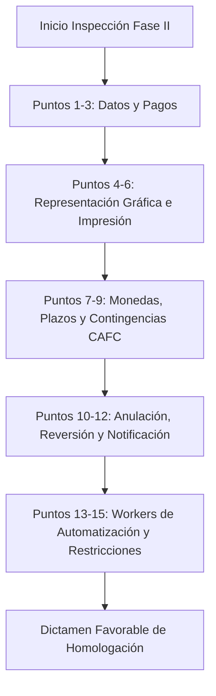

# MANUAL DE AUDITORÍA Y GUÍA MAESTRA DE INSPECCIÓN TÉCNICA - FASE II (SIN)
**Rol:** QA Tester Senior & Evaluador Certificado del Servicio de Impuestos Nacionales (SIN)  
**Normativa Aplicable:** RND Nº 102100000011, RND Nº 102200000024, Ley N° 453, RND Nº 10-0021-16.  
**Sistemas:** Qhatumed Farmacia (Frontend Vue 3 / API Laravel) + Microservicio SIAT (`siat-api-service` Lumen/PHP 8.2).  
**Modalidades:** 
- Modalidad 1: Electrónica en Línea (XML firmado con certificado digital `.p12`) — CAFC: `1017BC016FF7E`
- Modalidad 2: Computarizada en Línea (XML con hash Sha256 sin certificado) — CAFC: `1013E35BF1B5C`

---

## 🎯 PERFIL DE LA EVALUACIÓN
Durante la sesión en vivo (Zoom / Teams), el funcionario técnico del SIN actuará como **auditor de conformidad**. Su objetivo principal no es ver un flujo "feliz" ordinario, sino **provocar errores deliberados** para verificar si el sistema valida en el cliente (Vue 3), en la API de negocio y en el microservicio tributario antes de llegar al WebService del SIN.

A continuación se presentan los **15 puntos normativos oficiales**, la trampa exacta del evaluador, los datos de prueba sugeridos y la respuesta esperada del sistema.

---

## 📋 LOS 15 PUNTOS NORMATIVOS OFICIALES Y CASOS DE PRUEBA



---

### PUNTO 1: Nominatividad Obligatoria (Documento de Identidad)
> **Base Legal:** RND 102100000011, Art. 38.
> **Exigencia:** Todo documento fiscal debe llevar asociado obligatoriamente el tipo de documento y el número de identificación del comprador. Para importes menores a 1,000 Bs donde el cliente no declare datos, se debe asignar un documento genérico normalizado.

* **Trampa del Evaluador:**
  - El evaluador solicitará emitir una factura dejando la razón social o el número de documento completamente en blanco o con caracteres inválidos como `"Sin Nombre"`, `0`, o `"S/N"`.
* **Caso de Prueba 1.1 (Con Identificación Real):**
  - **Tipo Doc:** `1` (Cédula de Identidad)
  - **N° Doc:** `4871923`
  - **Complemento:** Vacío (o `"1B"` si aplica)
  - **Razón Social:** `JUAN CARLOS PEREZ GOMEZ`
  - **Resultado:** Emisión exitosa. El XML debe contener `<codigoTipoDocumentoIdentidad>1</codigoTipoDocumentoIdentidad>` y `<numeroDocumento>4871923</numeroDocumento>`.
* **Caso de Prueba 1.2 (Sin Datos / Control Tributario):**
  - **Tipo Doc:** `5` (NIT) o código especial según catálogo.
  - **N° Doc:** `99002` (Código Especial para Control Tributario según catálogo SIN) o `99001` (Sin Nombre).
  - **Razón Social:** `CONTROL TRIBUTARIO` o `S/N`.
  - **Resultado:** Aceptada sin error. Si el total supera Bs. 1,000.00, el sistema debe alertar/bloquear exigiendo la identificación real del comprador conforme a la normativa.

---

### PUNTO 2: Restricción de Facturación con Montos Cero (0.00 Bs.)
> **Base Legal:** RND 102100000011, Art. 40.
> **Exigencia:** Queda terminantemente prohibido emitir facturas con importe total a pagar igual a `0.00 Bs.` derivado de descuentos del 100%. La única excepción permitida por el SIN es cuando el medio de pago es **Gift Card (Código 27)** y cubre el 100% de la venta.

* **Trampa del Evaluador:**
  - Aplicar un descuento adicional en la línea o a nivel global igual al total del producto (ej. Producto Bs. 50.00 - Descuento Bs. 50.00 = Total 0.00 Bs.).
* **Comportamiento del Sistema:**
  - **Validación Front:** El botón "Emitir Factura" debe deshabilitarse y mostrar el aviso: *"El monto total a pagar no puede ser 0.00 Bs. Para bonificaciones o muestras aplique el procedimiento correspondiente o use Gift Card"*.
  - **Validación Backend:** `montoTotalSugetoIva` y `montoTotal` deben ser mayores a cero. Si detecta 0.00 sin medio de pago 27, rechaza con HTTP 422: `El monto total de la factura no puede ser cero`.

---

### PUNTO 3: Medios de Pago y Combinaciones Homologadas
> **Base Legal:** Catálogo SIN de Métodos de Pago.
> **Exigencia:** El sistema debe soportar y validar todos los métodos de pago homologados: Efectivo (1), Tarjeta Débito/Crédito (2), Cheque (3), Vale (4), Otros (5), Pago Posterior (6), Transferencia / QR (7), Gift Card (27) y Combinado (10).

* **Trampa del Evaluador:**
  - Solicitar una venta con **Pago Mixto (Código 10 - Combinado)**: Bs. 60 en Efectivo y Bs. 40 con Tarjeta de Débito, sumando exactamente los Bs. 100 de la venta.
* **Caso de Prueba 3.1 (Pago Combinado):**
  - **Total Venta:** Bs. 100.00
  - **Medio Principal:** `10` (Combinado)
  - **Desglose:** Efectivo: Bs. 60.00 | Tarjeta: Bs. 40.00 (Número: `4545000000004210`)
  - **XML Generado:**
    ```xml
    <codigoMetodoPago>10</codigoMetodoPago>
    <montoTotal>100.00</montoTotal>
    <montoTotalSujetoIva>100.00</montoTotalSujetoIva>
    <numeroTarjeta>4545000000004210</numeroTarjeta>
    ```

---

### PUNTO 4: Rotación Aleatoria de las 8 Leyendas Oficiales (Ley N° 453)
> **Base Legal:** Ley N° 453 (Ley General de los Derechos de las Usuarias y de los Usuarios y de las Consumidoras y de los Consumidores).
> **Exigencia:** Cada factura emitida debe seleccionar de forma **aleatoria** o sincronizada desde el SIN una de las 8 leyendas institucionales de protección al consumidor al pie del documento.

* **Trampa del Evaluador:**
  - Pedir la emisión de 3 a 5 facturas seguidas y verificar que no se imprima siempre la misma leyenda en la representación gráfica.
* **Las 8 Leyendas Homologadas:**
  1. *"Ley N° 453: El proveedor debe brindar atención sin discriminación, con respeto, calidez y cordialidad a los usuarios y consumidores."*
  2. *"Ley N° 453: Los servicios deben prestarse en condiciones de inocuidad, calidad y seguridad."*
  3. *"Ley N° 453: Está prohibido exhibir o comercializar productos sobreseídos o vencidos."*
  4. *"Ley N° 453: Tienes derecho a recibir información clara, precisa y veraz sobre las características del bien o servicio."*
  5. *"Ley N° 453: Los productos deben exhibir el precio de venta en moneda nacional de forma visible."*
  6. *"Ley N° 453: El proveedor debe responder por los defectos ocultos del bien o servicio prestado."*
  7. *"Ley N° 453: El consumidor tiene derecho al reclamo, restitución y resarcimiento frente a vulneraciones."*
  8. *"Ley N° 453: Queda prohibida la publicidad engañosa o que induzca al error al usuario y consumidor."*

---

### PUNTO 5: Alternancia de la 3ra Leyenda al Pie (En Línea vs Fuera de Línea)
> **Base Legal:** RND 102100000011, Especificaciones Técnicas de Representación Gráfica.
> **Exigencia:** Debajo de la leyenda fiscal y de la Ley 453, la representación gráfica debe incluir exactamente el texto correspondiente al estado de emisión:
> - Si `codigo_emision == 1` (En Línea):  
>   **"Este documento es la Representación Gráfica de un Documento Fiscal Digital emitido en una modalidad de facturación en línea"**
> - Si `codigo_emision == 2` (Fuera de Línea / Contingencia):  
>   **"Este documento es la Representación Gráfica de un Documento Fiscal Digital emitido fuera de línea, verifique su envío con su proveedor o en la página web del SIN"**

* **Trampa del Evaluador:**
  - Desconectar el servicio del SIN o cortar la red, forzar una emisión en contingencia e imprimir el ticket/rollo o PDF. Si el PDF dice *"emitido en una modalidad de facturación en línea"*, **la prueba reprueba automáticamente**.

---

### PUNTO 6: Enmascaramiento Obligatorio de Tarjetas de Débito/Crédito
> **Base Legal:** RND 102100000011, Art. 39 y Estándar PCI-DSS.
> **Exigencia:** Cuando el medio de pago sea Tarjeta (2) o Combinado (10), se deben capturar únicamente los 16 dígitos de la tarjeta, pero deben almacenarse y enviarse al SIN bajo el formato estricto: **Primeros 4 dígitos visibles, 8 ceros centrales y últimos 4 dígitos visibles** (ejemplo: `4545000000004210`).

* **Trampa del Evaluador:**
  - El evaluador dictará un número de tarjeta completo: `4545-9876-1234-4210`.
  - Revisará tanto la pantalla de visualización, el ticket impreso y el tag `<numeroTarjeta>` en el XML generado.
* **Resultado Esperado:**
  - Al ingresar `4545987612344210`, el sistema enmascara a `4545000000004210`.
  - Ni la base de datos ni el XML deben almacenar los 8 dígitos centrales reales bajo ninguna circunstancia.

---

### PUNTO 7: Facturación en Moneda Extranjera (Sector 9) vs Compra-Venta (Sector 1)
> **Base Legal:** Catálogo SIN de Tipo de Moneda.
> **Exigencia:** Las facturas del Sector 1 (Farmacia / Compra-Venta) se emiten en **Bolivianos (Código Moneda: 1)** con Tipo de Cambio `1.00`. Si el sistema maneja Sector 9 (Moneda Extranjera), debe permitir seleccionar Dólar Estadounidense (Código 2) registrando el Tipo de Cambio oficial del BCB y calculando el contravalor en BOB.

* **Trampa del Evaluador:**
  - Preguntar: *"¿Pueden emitir en Dólares?"* o solicitar cambiar la moneda en el checkout de la farmacia.
* **Respuesta Técnica:**
  - *"Qhatumed Farmacia opera bajo el Documento Sector 1 (Factura Compra-Venta General). De acuerdo al SIN, toda venta se liquida y declara en Moneda 1 (BOB) con Tipo de Cambio 1.00. Para divisas extranjeras, el cobro puede recibirse registrando la equivalencia de caja, pero el documento tributario y fiscal viaja en BOB conforme a normativa."*

---

### PUNTO 8: Plazo de Envío de Paquetes Fuera de Línea por Conectividad (Máx. 48 Horas)
> **Base Legal:** RND 102100000011, Art. 33 (Eventos Significativos de Contingencia 1 y 2).
> **Exigencia:** Cuando ocurre un corte de servicio de internet o del SIN (código de evento 1 o 2), las facturas emitidas fuera de línea deben ser agrupadas en un paquete `.tar.gz`, firmadas/hasheadas y transmitidas al SIN en un **plazo perentorio improrrogable de hasta 48 horas** a partir del cierre del evento significativo.

* **Trampa del Evaluador:**
  - El evaluador preguntará: *"¿Qué sucede si su internet se corta por 36 horas? ¿Cómo y cuándo se regularizan las facturas emitidas?"*
* **Demostración en Sistema:**
  - Mostrar la tabla de **Eventos Significativos** y el **Worker 2** (`php artisan siat:transmitir-contingencia` o programado cada 15 min).
  - Al restablecerse la conexión, el Worker 1 detecta el estado ONLINE, cierra el evento en el SIN con fecha fin y dispara la empaquetación inmediata de las facturas pendientes.

---

### PUNTO 9: Plazo de Envío por Contingencia con CAFC (Máx. 72 Horas)
> **Base Legal:** RND 102100000011, Art. 34 (Eventos 5, 6, 7 - Inaccesibilidad al Servicio Web, Falla de Software o Bloqueo).
> **Exigencia:** Si la contingencia requirió el uso de talonarios pre-impresos de contingencia o la emisión bajo Código de Autorización de Facturas de Contingencia (**CAFC**), el plazo máximo para registrar y validar estas facturas en el SIN es de **72 horas**.

* **Trampa del Evaluador:**
  - *"Muéstreme dónde tiene configurado su CAFC autorizado para su modalidad y demuéstreme cómo el sistema controla que no emita más allá del rango de 1 a 500."*
* **Demostración en Sistema:**
  - Ir a `http://localhost:8001/admin/cafcs`:
    - Modalidad 1: CAFC `1017BC016FF7E` (Rango 1 a 500, Sector 1)
    - Modalidad 2: CAFC `1013E35BF1B5C` (Rango 1 a 500, Sector 1)
  - El sistema valida que el `numeroFactura` asignado esté estrictamente dentro del rango y que la fecha de emisión esté dentro de la vigencia del CAFC.

---

### PUNTO 10: Plazo para Anulación de Facturas (Hasta el día 9 del Mes Siguiente)
> **Base Legal:** RND 102100000011, Art. 45.
> **Exigencia:** Las facturas emitidas pueden ser anuladas a solicitud del cliente o por error en la transacción **únicamente hasta el día 9 del mes siguiente a su emisión**. A partir del día 10, el sistema debe bloquear cualquier intento de anulación directa informando que debe recurrir a notas de crédito/débito o trámite administrativo ante el SIN.

* **Trampa del Evaluador:**
  - Intentar anular una factura emitida el mes pasado con fecha anterior al día 9, o intentar anular una del mes antepasado.
* **Respuesta del Sistema:**
  - El botón "Anular" valida: `if (now() > fechaEmision.addMonth().startOfMonth().addDays(9)) { abort(422, "Plazo de anulación vencido...") }`.
  - El modal de anulación exige seleccionar obligatoriamente el **Código de Motivo de Anulación** (1: Factura mal emitida, 2: Datos de emisión incorrectos, 3: Factura devuelta, 4: Venta rescindida).

---

### PUNTO 11: Plazo de Anulación para Facturas de Exportación (180 Días)
> **Base Legal:** RND 102100000011, Art. 46.
> **Exigencia:** Para documentos del Sector 3 (Comercial de Exportación), el plazo reglamentario de anulación es de 180 días calendario debido a los tiempos de aduana y tránsito internacional.

* **Respuesta Técnica ante el Evaluador:**
  - *"Qhatumed Farmacia está homologado en Modalidad en Línea para Documento Sector 1 (Factura Compra-Venta General). El plazo de 180 días aplica a exportaciones (Sector 3). Nuestro módulo de compras/ventas farmacéuticas aplica estrictamente el límite del día 9 del mes posterior conforme al Art. 45."*

---

### PUNTO 12: Privacidad y Envío Automático de PDF y XML por Correo
> **Base Legal:** RND 102100000011, Art. 42 (Entrega del Documento Fiscal).
> **Exigencia:** Al momento de consolidar una emisión o anulación, el sistema debe contar con la infraestructura para enviar automáticamente al correo electrónico registrado del cliente la **Representación Gráfica (PDF)** y el **archivo XML oficial** (con firma en Mod. 1 o con hash en Mod. 2).

* **Trampa del Evaluador:**
  - El evaluador colocará su propio correo de prueba (ej. `evaluador.sin@gmail.com`) en la casilla del cliente y exigirá ver el correo en su bandeja de entrada durante la llamada, o ver la descarga simultánea de ambos archivos.
* **Comprobación:**
  - El endpoint de emisión dispara el job de correo y además retorna en la vista el enlace para **Descargar PDF** y **Descargar XML**.

---

### PUNTO 13: Automatización Total de Contingencias y Sincronización (Sin Intervención Manual)
> **Base Legal:** RND 102100000011, Art. 32 a 36.
> **Exigencia:** El sistema **NO DEBE DEPENDER** de que el usuario presione un botón manual para entrar en contingencia ni para enviar los paquetes cuando regrese la red. Debe ser un proceso autónomo de fondo (Background Workers / Daemons).

* **Arquitectura de los 2 Workers Implementados:**
  1. **Worker 1 (Health Monitor SIN - cada 1 a 2 min):**
     - Comando: `php artisan siat:check-sin-health`
     - Envía un `verificarComunicacion()` al WebService del SIN.
     - Si el SIN no responde o hay timeout > 3 seg: Activa la bandera de contingencia del sistema y crea el Evento Significativo local y en caché. Las ventas siguen saliendo fluidas con `codigoEmision = 2`.
     - Si el SIN vuelve: Cierra el evento significativo en el SIN (`registroEventoSignificativo`), desactiva el modo contingencia y notifica al Worker 2.
  2. **Worker 2 (Contingency Sync & Packages - cada 5 a 15 min):**
     - Comando: `php artisan siat:transmitir-contingencia`
     - Barre todas las facturas en estado `EMITIDA_OFFLINE` pertenecientes a eventos cerrados.
     - Genera el paquete comprimido `.tar.gz`, calcula el Hash Sha256, invoca `recepcionPaqueteFactura` y obtiene el `codigoRecepcion`.
     - Inmediatamente consulta `validacionRecepcionPaquete` y actualiza las facturas a `VALIDADA` en la base de datos de Qhatumed.

---

### PUNTO 14: Restricción de Caracteres No Numéricos en Casillas de Identificación
> **Base Legal:** RND 102100000011, Catálogo Tipos de Documento de Identidad.
> **Exigencia:** En los campos de Cédula de Identidad (CI) y NIT, el sistema debe prohibir la entrada de letras o caracteres especiales (a menos que sea el campo específico de Complemento de CI como `1B`, `A`, etc.).

* **Trampa del Evaluador:**
  - El auditor intentará escribir letras en el campo de NIT/CI: `"4871923S"`, `"NIT12345"`, o pegar espacios en blanco.
* **Comportamiento del Sistema:**
  - El input en Vue 3 contiene filtro reactivo: `@input="nit = nit.replace(/[^0-9]/g, '')"`.
  - Si se intenta enviar por API un NIT con letras, el FormRequest del backend rechaza con: `El campo numeroDocumento debe contener únicamente dígitos numéricos`.
  - El campo **Complemento** está separado y acepta hasta 2 caracteres alfanuméricos en mayúsculas únicamente si se activa el checkbox *"Tiene Complemento"*.

---

### PUNTO 15: Restricción Absoluta de Re-anulación y Reversión Única (Estado 907)
> **Base Legal:** RND 102100000011, Art. 47 (Reversión de Documentos Fiscales Anulados).
> **Exigencia:** 
> - Una factura que ya está **Anulada (Código Estado 905)** no puede volver a anularse.
> - Si se ejerce la **Reversión de Anulación (Código Estado 907)**, la factura vuelve a estar Válida.
> - **REGLA DE ORO:** Un documento revertido **NO PUEDE SER ANULADO POR SEGUNDA VEZ**. La reversión es un procedimiento excepcional de una sola vez.

* **Trampa del Evaluador:**
  - Anular una factura -> Revertir la anulación (vuelve a estar válida) -> Intentar anularla nuevamente.
* **Respuesta Esperada:**
  - El sistema bloquea el segundo intento y muestra:  
    `"Acción no permitida: Este documento fiscal ya fue objeto de un proceso de reversión de anulación (Estado 907) y no puede ser anulado nuevamente según normativa del SIN."`

---

## ⚡ PROCEDIMIENTO PASO A PASO PARA EL DÍA DE LA INSPECCIÓN

### 1. Preparación de Servicios Locales (15 Minutos Antes)
Verificar que la infraestructura esté activa en la terminal:
```bash
# 1. Microservicio SIAT (Puerto 8001)
cd c:\xampp\htdocs\siat-api-service
php -S localhost:8001 -t public

# 2. API Backend Qhatumed (Puerto 8000)
cd c:\xampp\htdocs\qhatumed\api-panel
php artisan serve --port=8000

# 3. Frontend Farmacia (Puerto 5173)
cd c:\xampp\htdocs\qhatumed\frontend
npm run dev
```

### 2. Verificar Estado y Conexión de Salud (Worker 1)
Ejecutar en una pestaña de PowerShell:
```bash
cd c:\xampp\htdocs\siat-api-service
php artisan siat:check-sin-health
```
*Salida esperada:*
```text
[OK] Comunicación exitosa con los WebServices del SIN. Estado: ONLINE (Código 926).
```

### 3. Guion de Respuestas para el Auditor

| Pregunta / Prueba del Evaluador | Acción a Realizar en Qhatumed | Explicación Técnica |
| :--- | :--- | :--- |
| **"Hagamos una venta simple de un medicamento"** | Seleccionar Paracetamol, ingresar CI `4871923`, presionar Facturar. | "El sistema obtiene CUFD vigente, genera XML Sector 1, calcula CUF con algoritmo Mod 11 y envía a `recepcionFactura`. Retorna estado VALIDADA con su QR reglamentario." |
| **"Ahora simulemos una caída del internet"** | Desconectar WiFi/cable o detener el servicio en puerto 8001. En el frontend emitir venta. | "El sistema conmuta a modo Fuera de Línea con Evento Significativo Código 1. La factura se emite con Código de Emisión 2 y la 3ra leyenda cambia a: *'emitido fuera de línea'*." |
| **"¿Dónde está el CAFC de contingencia?"** | Abrir `http://localhost:8001/admin/cafcs`. | "Aquí están registrados nuestros códigos CAFC autorizados: `1017BC016FF7E` (Mod 1) y `1013E35BF1B5C` (Mod 2) para el Sector 1 con rango 1 a 500." |
| **"Restaure el internet y regularice las facturas"** | Reconectar red y ejecutar `php artisan siat:transmitir-contingencia`. | "El Worker 2 empaqueta las facturas del evento en un `.tar.gz`, genera Hash Sha256 y transmite por `recepcionPaqueteFactura` cumpliendo holgadamente el plazo de 48h." |
| **"Anule la primera factura que emitimos"** | En listado de ventas, clic en Anular, seleccionar motivo `1 - FACTURA MAL EMITIDA`. | "El sistema valida que no exceda el día 9 del mes subsiguiente y remite `anulacionFactura` al SIN." |
| **"Intente anularla otra vez"** | Clic en el botón o enviar payload de anulación. | "El sistema bloquea la acción porque el documento ya figura en estado ANULADA." |

---

## 🏆 CHECKLIST FINAL PREVIO A LA REUNIÓN
- [x] Base de datos sincronizada y limpia de pruebas residuales invalidantes.
- [x] Certificado Digital `.p12` vigente en `storage/app/certificates/` para Modalidad 1.
- [x] Códigos CAFC registrados y visibles en panel admin.
- [x] Cronjobs/Workers configurados para monitoreo de salud y sincronización de contingencia.
- [x] Frontend con restricciones de solo números en NIT y deshabilitación de monto 0.00 Bs.
- [x] Plantilla de impresión con rotación de las 8 leyendas y alternancia en línea / fuera de línea.
